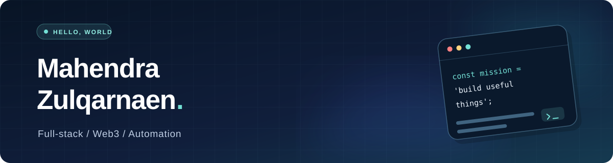

  

  <strong>Software Engineer · Full-stack Products · Web3 · Automation</strong>

  I build useful software end to end: thoughtful interfaces, dependable backends, and the systems that connect them.

  
  

---

### Featured work

| Project | What I built | Stack |
| --- | --- | --- |
| 📸 **[InWebBooth](https://github.com/Mahendraz/photoboots)** · [Try the app](https://photobooth.inwebsite.online/) | A browser-based photobooth with flexible layouts, filters, stickers, and high-resolution exports. Photo editing happens in the browser. | React, TypeScript, Vite, Cloudflare Workers & D1 |
| 📦 **[StockFlow](https://github.com/Mahendraz/StockFlow)** | An inventory and invoicing app with authentication, transaction-safe stock updates, and automated tests. | Next.js, TypeScript, MongoDB, Vitest |

### Tools & technologies

  
  
  
  
  
  
  

### What I care about

- **Product thinking:** software should be pleasant to use and solve a real problem.
- **Reliable engineering:** clear architecture, security-conscious defaults, and testable business logic.
- **Curiosity:** exploring full-stack development, smart contracts, and workflow automation.

My earlier projects explored Solidity and Web3 application patterns. I enjoy applying those lessons to practical full-stack products.

---

  Build with care. Keep learning. Ship what matters.

